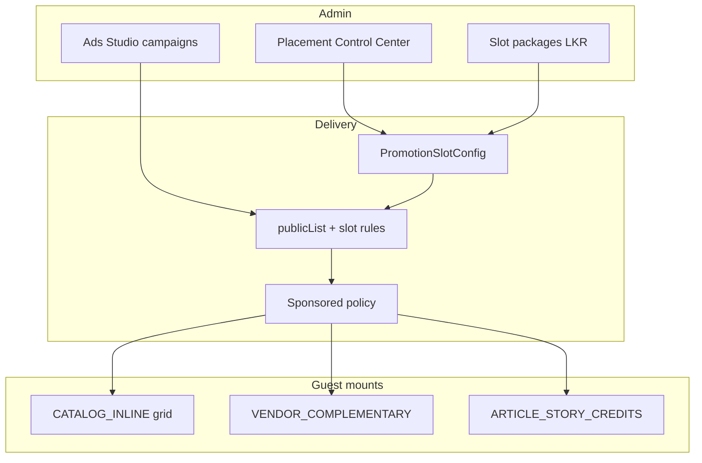

# Ads module — Placement Control + Tier 1 revenue

## Problem

Campaign CRUD exists ([`Promotion`](packages/database/prisma/schema.prisma), [`/admin/ads`](apps/web/src/features/admin/ads/ads-page.tsx), [`/pro/promote`](apps/web/src/features/pro/promote/promote-page.tsx)), but **placement is developer-owned**:

- Only `HOME_HERO`, `HOME_PICKS`, `CATALOG_TOP` mount via hardcoded [`PromotionSlotRail`](apps/web/src/components/promotion-slot-rail.tsx)
- `SLOT_META.live` in [`ads-studio.tsx`](packages/ui/src/domain/ads-studio.tsx) is cosmetic
- Free-text `badgeLabel` lets paid creatives show “Ceylon Pick”
- No per-slot enablement, density, layout defaults, or pricing

Chosen approach: **foundation first**, then the three recommended first builds from [Advertising Plan](Ceylon%20Weddings%20—%20Advertising%20Plan%20for%20Guest%20Pages.md). Per-slot **pricing packages** are in scope; full PayHere/Stripe promo checkout stays a thin “mark paid / request purchase” path that reuses existing payment patterns later if needed.

---

## Phase 0 — Schema & contracts

### Extend `PromotionSlot` enum

Keep existing six; add plan slots (even if not all mount yet):

- `CATALOG_DATE_AVAILABLE`, `CATALOG_MAP`
- `VENDOR_COMPLEMENTARY`, `VENDOR_SIMILAR` (retire unused `VENDOR_SIDEBAR` as alias → map to `VENDOR_SIMILAR` in UI meta, or keep both and mark sidebar deprecated)
- `COMPARE_SUGGEST`
- `IDEAS_INLINE`, `ARTICLE_INLINE`, `ARTICLE_NEXT_STEP`, `ARTICLE_STORY_CREDITS` (Shop this wedding boost)
- `REELS`, `AWARDS_CATEGORY`

Update in lockstep: Prisma enum, [`promotionSlotSchema`](packages/contracts/src/promotion/promotion.ts), `SLOT_META` / `PROMOTION_SLOTS`.

### New `PromotionSlotConfig` model

One row per slot (seeded for all enum values):

| Field                                 | Purpose                                                                                                                            |
| ------------------------------------- | ---------------------------------------------------------------------------------------------------------------------------------- |
| `slot`                                | Unique `PromotionSlot`                                                                                                             |
| `enabled`                             | Admin on/off (replaces `SLOT_META.live`)                                                                                           |
| `pageKey`, `regionKey`, `description` | Inventory copy for admin                                                                                                           |
| `defaultLayout`                       | `PromotionLayout`                                                                                                                  |
| `maxPerRequest`                       | Caps public fetch                                                                                                                  |
| `densityEveryN`                       | Catalog inline: e.g. 12 (positions 1, 6 handled in resolver)                                                                       |
| `disclosure`                          | `SPONSORED` \| `SPONSORED_STORY` \| `CUSTOM`                                                                                       |
| `priceLkr`, `interval`                | List price (mirror [`SubscriptionPlan`](packages/database/prisma/schema.prisma) style: `WEEKLY`/`MONTHLY` or `DAY`/`WEEK`/`MONTH`) |
| `currency`                            | Default `LKR`                                                                                                                      |
| `sortOrder`                           | Admin UI order                                                                                                                     |
| `notes`                               | Internal                                                                                                                           |

### New `PromotionPackage` model (sellable bundles)

Admin-defined packages vendors browse in Promote studio:

- `name`, `slug`, `description`, `slots[]`, `priceLkr`, `interval`, `durationDays`, `active`, `sortOrder`, `stripePriceId?`
- Optional link from campaign: `Promotion.packageId`

Checkout for packages: **admin can set prices and assign packages**; vendor flow shows package picker → creates campaign as `PAID_PENDING`; admin marks `PAID` / activates. Wire PayHere later against `packageId` the same way as subscription checkout — not blocking Phase 0–2.

### Label & featured decoupling

- Enforce disclosure in API + `PromotionCreative`: if `source` is `PAID` / `PAID_PENDING` **or** slot config `disclosure !== CUSTOM`, public badge = “Sponsored” / “Sponsored story” (ignore conflicting `badgeLabel` like “Ceylon Pick”).
- Stop [`syncVendorFeatured`](apps/api/src/modules/admin/promotions.service.ts) from flipping editorial `Vendor.featured` for paid promos (or split: paid boost ≠ Ceylon Pick). Seed: fix promo `badgeLabel`.

### Article story credits (for Shop this wedding)

Extend `Article` with `vendorIds String[]` (or join table `ArticleVendorCredit { articleId, vendorId, role?, sortOrder, boosted }`). Boosted credits surface WhatsApp CTA when an active `ARTICLE_STORY_CREDITS` promo exists for that vendor.

---

## Phase 1 — Placement Control Center (admin)

**Route:** `/admin/ads/placements` (nav under Ads)

**Capabilities:**

1. Table of all slots: page, region, enabled toggle, default layout, max, density, disclosure, **price LKR + interval**
2. Edit drawer for one slot
3. Packages CRUD (`/admin/ads/packages` or tab on same page)
4. Preview: “which campaigns would fill this slot now” using existing `publicList` filters
5. Keep global `ads.public` as master kill; disabled slot returns empty even if campaigns target it

**API:**

- `GET/PUT /admin/promotion-slots` (list + upsert config)
- `GET/POST/PUT/DELETE /admin/promotion-packages`
- `GET /public/promotion-slots` — enabled slots + public-safe fields (layout, max, disclosure) for guest mounts; **no** need to hardcode limits in React

**Refactor delivery:**

- [`promotions.service.ts` `publicList`](apps/api/src/modules/admin/promotions.service.ts): reject if slot config `enabled === false`; apply `maxPerRequest`; attach `effectiveBadge` / `effectiveLayout`
- [`PromotionSlotRail`](apps/web/src/components/promotion-slot-rail.tsx): read slot config for limit/layout; drop parent overrides where config owns them
- Studio `SlotPicker`: show price + “Not enabled” from config API (not static `live`)

---

## Phase 2 — Tier 1 guest placements

### 1. Catalog native Sponsored cards (`CATALOG_INLINE`)

In [`vendors-catalog.tsx`](apps/web/src/features/vendors/vendors-catalog.tsx):

- Remove / deprecate top `CATALOG_TOP` strip when `CATALOG_INLINE` enabled (admin can disable `CATALOG_TOP`)
- Inject sponsored `VendorCard`-shaped units at positions **1, 6, then every `densityEveryN`** among filtered results
- Pass `city` + `category` into public query (today city is missing on catalog rail)
- Force Sponsored label; never Ceylon Pick
- Same card chrome as organic results

Delivery helper: `resolveCatalogInline(results, promos, config)` — dedupe vendor once per view; skip if promo vendor fails active filters.

### 2. Complete your team (`VENDOR_COMPLEMENTARY`)

On [`vendors-detail-page.tsx`](apps/web/src/features/vendors/vendors-detail-page.tsx), below reviews:

- Fetch promos for `VENDOR_COMPLEMENTARY` with current vendor’s city
- Server rule: complementary categories only (static map e.g. PHOTO → DECOR/VENUE/…; never same category)
- Section title: “Couples who booked {name} also booked…” + Sponsored

### 3. Shop this wedding (`ARTICLE_STORY_CREDITS`)

On idea article page for `REAL_WEDDING` (and any article with credits):

- Admin content editor: attach credited vendors
- Public: photo tags / end “Vendors in this story” box ([`GuestVendorCredit`](packages/ui/src/domain/team-vendor.tsx) pattern)
- If vendor has live `ARTICLE_STORY_CREDITS` promo → WhatsApp button + Sponsored mark on that credit

---

## Phase 3 — Studio + measurement polish

- Promote studio: package picker with prices from admin packages; only **enabled** slots selectable
- Admin ads list: filter by slot; show package + revenue metadata
- Per-slot impression/click breakdown (group existing `AnalyticsEvent` by `meta.slot` — add slot to track payload if missing)
- Docs: update [`docs/DATA_MODEL.md`](docs/DATA_MODEL.md), [`docs/MODULES.md`](docs/MODULES.md), IA for `/admin/ads/placements`

**Explicitly out of this plan:** map pins, compare suggest, Ideas inline grid, reels strip, awards sponsor, animated SVG motifs, 5% holdout experiment, full promo PayHere checkout (package prices + PAID_PENDING → admin PAID is enough to sell manually).

---

## Key files

| Area      | Files                                                                                                                                                                                                                                                            |
| --------- | ---------------------------------------------------------------------------------------------------------------------------------------------------------------------------------------------------------------------------------------------------------------- |
| Schema    | [`packages/database/prisma/schema.prisma`](packages/database/prisma/schema.prisma)                                                                                                                                                                               |
| Contracts | [`packages/contracts/src/promotion/promotion.ts`](packages/contracts/src/promotion/promotion.ts)                                                                                                                                                                 |
| API       | [`apps/api/src/modules/admin/promotions.service.ts`](apps/api/src/modules/admin/promotions.service.ts), controller                                                                                                                                               |
| Studio UI | [`packages/ui/src/domain/ads-studio.tsx`](packages/ui/src/domain/ads-studio.tsx)                                                                                                                                                                                 |
| Admin     | new `features/admin/ads/placements-page.tsx`, extend ads nav                                                                                                                                                                                                     |
| Guest     | [`vendors-catalog.tsx`](apps/web/src/features/vendors/vendors-catalog.tsx), [`vendors-detail-page.tsx`](apps/web/src/features/vendors/vendors-detail-page.tsx), ideas article page, [`promotion-slot-rail.tsx`](apps/web/src/components/promotion-slot-rail.tsx) |

---

## Success criteria

- Admin can enable/disable any slot, set max/density/disclosure/price without a deploy
- Paid units always show Sponsored; Ceylon Pick remains editorial-only
- Catalog shows filter-aware sponsored cards; profile shows complementary Sponsored strip; real-wedding articles show credited vendors with optional boosted WhatsApp
- Vendors see package prices in Promote; admin can fulfill PAID_PENDING → ACTIVE
