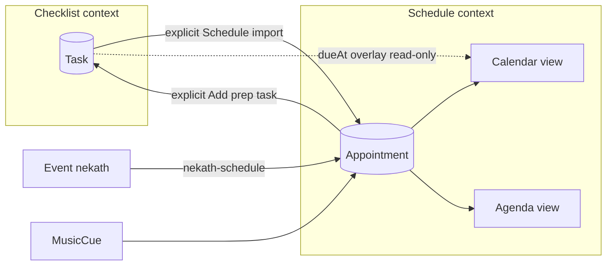

# Checklist · Calendar · Agenda — research plan and coupling design

## Research verdict

Industry practice (Nuzio, Folia, That’s The One) and this repo’s own IA agree: **three jobs, not one “timeline.”**

| Surface       | Job                                         | Time horizon              | Data owner                                                             |
| ------------- | ------------------------------------------- | ------------------------- | ---------------------------------------------------------------------- |
| **Checklist** | What work must get done                     | Months → weeks out        | `Task`                                                                 |
| **Calendar**  | When commitments sit on the clock           | Engagement + wedding day  | `Appointment` (all kinds)                                              |
| **Agenda**    | Ordered day-of run-of-show for one ceremony | Wedding day (per `Event`) | Same `Appointment` rows, filtered by `eventId`, ordered by `sortOrder` |

Agenda and Calendar are **two editors on one store**, not two features with separate tables. Checklist is a **separate bounded context**. Docs still often say “Checklist & Timeline” ([docs/MODULES.md](docs/MODULES.md), [docs/CORE_MODULES.md](docs/CORE_MODULES.md)) while IA already lists three routes ([docs/INFORMATION_ARCHITECTURE.md](docs/INFORMATION_ARCHITECTURE.md)).



---

## Research gaps addressed

### A. Product / docs gaps (close first — they drive wrong builds)

1. **Conflated module name** — “Checklist & Timeline” folds run-of-show into tasks. Split module 3 into **Checklist** + **Calendar** + **Agenda** in [docs/MODULES.md](docs/MODULES.md), [docs/CORE_MODULES.md](docs/CORE_MODULES.md), [docs/MVP_MODULES.md](docs/MVP_MODULES.md).
2. **Stale phase notes** — [docs/UI_LAYOUT_PLAN.md](docs/UI_LAYOUT_PLAN.md) still implies checklist stood in for calendar; update to shipped three-route model.
3. **Hub naming bug** — widget id `agenda` labeled “Coming up” links to **Calendar**, not Agenda ([couple-widgets.ts](apps/web/src/features/planning/overview/couple-widgets.ts), [overview-page.tsx](apps/web/src/features/planning/overview/overview-page.tsx)). Rename to `upcoming_schedule` / “Coming up”; add a separate optional `run_sheet` widget → `/planning/agenda?eventId=…`.
4. **Unused i18n** — `knotly.openAgenda`, `nav.timeline` — wire or remove.
5. **AI checklist orphan** — `POST /ai/checklist` exists but never persists to `Task`; document as Phase 2 or wire with explicit “Import AI tasks” (out of triad coupling v1 except note).

### B. Domain ownership gaps (prevent dual-write chaos)

Canonical write rules (document in DATA_MODEL + enforce in UI copy):

- **Calendar owns clock time** — `startsAt` / `endsAt` (drag-reschedule stays here).
- **Agenda owns ceremony order** — `sortOrder` for `eventId`-scoped day-of blocks; time edits allowed but always show “Also on calendar.”
- **Checklist owns status lifecycle** — `TODO` / `DOING` / `DONE`; `dueAt` is a deadline, not a time block.
- **Nekath owns seed** — `POST …/nekath-schedule` is couple-only; must become **idempotent replace** of previously generated day-of rows for that event (today it appends duplicates — [weddings.service.ts](apps/api/src/modules/weddings/weddings.service.ts)).

Do **not** unify into one `PlanningItem` model. Do **not** bidirectional-sync title/status/time on every edit. Follow the existing **MusicCue → Appointment** optional-FK pattern.

### C. Coupling / “import from each” (distributed modules, explicit bridges)

v1 bridges (user-initiated imports, not silent sync):

| From → To                      | Action                   | Mechanism                                                                                                                                                      |
| ------------------------------ | ------------------------ | -------------------------------------------------------------------------------------------------------------------------------------------------------------- |
| Checklist → Calendar           | **Schedule**             | Create `Appointment` from task; set `Task.appointmentId` (new optional FK). Default window: `dueAt` day 10:00–11:00 Colombo, kind `OTHER` or `VENDOR_MEETING`. |
| Calendar/Agenda → Checklist    | **Add prep task**        | Create `Task` with title/notes from appointment; optional `Task.appointmentId`.                                                                                |
| Checklist → Calendar (overlay) | **Show due dates**       | Read-only chips on calendar days for tasks with `dueAt` (Nuzio pattern); click → checklist `?taskId=`. No fake appointments.                                   |
| Agenda ↔ Calendar              | **Deep links both ways** | Keep agenda → calendar (`focus` + `highlight`); add calendar → agenda when `eventId` set (`/planning/agenda?eventId=&highlight=`). Use `knotly.openAgenda`.    |
| Ceremonies hub → Agenda        | **Open run sheet**       | From `ceremonies` widget, link next event to agenda.                                                                                                           |

Schema delta (minimal):

```prisma
model Task {
  // existing fields...
  appointmentId String?
  appointment   Appointment? @relation(fields: [appointmentId], references: [id], onDelete: SetNull)
}
```

Validate appointment belongs to same wedding (same as [music.service.ts](apps/api/src/modules/weddings/music.service.ts) `assertAppointment`). Contracts: extend [tasks.ts](packages/contracts/src/wedding/tasks.ts); API create/update accept `appointmentId`; list appointments unchanged.

### D. Permission / API gaps

Today: task/appointment API = any wedding member; checklist/agenda UI gate on `COUPLE || canEditGuests`; **calendar UI has no gate**.

Define one matrix and apply to API + all three UIs:

- **`canEditSchedule`** = role `COUPLE` OR `canEditGuests` (reuse flag; document as schedule+tasks until a dedicated flag is needed).
- Nekath regenerate remains **couple-only**.
- Gate calendar create/edit/drag the same as agenda.

### E. Couple hub gaps

- Fix widget naming/links (above).
- Extend `hubStats` or hub fetch with: open tasks count (already partial), next appointment, “run sheet ready” (any day-of blocks for next event).
- Optionally add checklist/run-sheet signals to `weddingCompleteness` later — not blocking for bridge v1.
- Make “Coming up” rows clickable → calendar highlight.

### F. Operational gaps on shared Appointment store

- Tag or replace nekath-generated rows (e.g. `notes` prefix / `kind` + known titles, or add `source: NEKATH | MANUAL` enum if cleaner).
- When calendar creates with no `eventId`, optional nudge: “Attach to ceremony to appear on Agenda.”
- Align music page to use `agendaForEvent` sort so cue picker matches agenda order.

---

## Implementation phases

### Phase 0 — Research closure (docs + naming)

- Rewrite module docs to three surfaces; update DATA_MODEL ownership section.
- Rename hub widget; wire Calendar ↔ Agenda deep links; i18n cleanup.
- No schema yet.

### Phase 1 — Hardening shared schedule

- Nekath regenerate idempotent.
- Calendar permission gate = agenda.
- API enforce `canEditSchedule` for task + appointment mutations.

### Phase 2 — Modular import bridges

- Migration: `Task.appointmentId`.
- Checklist: “Schedule on calendar” + link chip when linked.
- Appointment editor (calendar + agenda): “Add prep task.”
- Calendar: due-date overlay for tasks.
- Checklist deep link `?taskId=` / highlight.

### Phase 3 — Hub + completeness polish

- Separate “Coming up” vs “Run sheet” widgets.
- Clickable rows; ceremonies → agenda.
- Optional completeness checks for checklist progress / run sheet seeded.

### Out of scope for this plan

- Unified PlanningItem rewrite.
- Bidirectional field sync.
- ICS/Google import (when added: appointments only; tasks stay CSV/templates).
- Persisting AI checklist (track separately; can reuse createTask batch).

---

## Key files

- Schema: [packages/database/prisma/schema.prisma](packages/database/prisma/schema.prisma)
- Contracts: [packages/contracts/src/wedding/tasks.ts](packages/contracts/src/wedding/tasks.ts), [appointments.ts](packages/contracts/src/wedding/appointments.ts), [helpers.ts](packages/contracts/src/wedding/helpers.ts)
- API: [apps/api/src/modules/weddings/weddings.service.ts](apps/api/src/modules/weddings/weddings.service.ts)
- UI: [checklist-page.tsx](apps/web/src/features/planning/checklist/checklist-page.tsx), [agenda-page.tsx](apps/web/src/features/planning/agenda/agenda-page.tsx), [calendar-page.tsx](apps/web/src/features/planning/calendar/calendar-page.tsx), [appointment-editor.tsx](apps/web/src/features/planning/components/appointment-editor.tsx)
- Hub: [overview-page.tsx](apps/web/src/features/planning/overview/overview-page.tsx), [couple-widgets.ts](apps/web/src/features/planning/overview/couple-widgets.ts)
- Precedent: MusicCue ↔ Appointment in music feature

---

## Success criteria

- Couples can explain three different jobs without “timeline” ambiguity.
- Importing is always an explicit action; deleting a task does not delete an appointment (and vice versa) unless user chooses.
- Agenda order and calendar time can diverge intentionally without silent overwrite.
- Hub never mislabels Agenda as Calendar.
- Family members without edit rights cannot mutate schedule via calendar UI or API.
